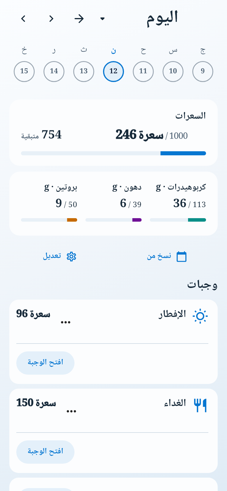
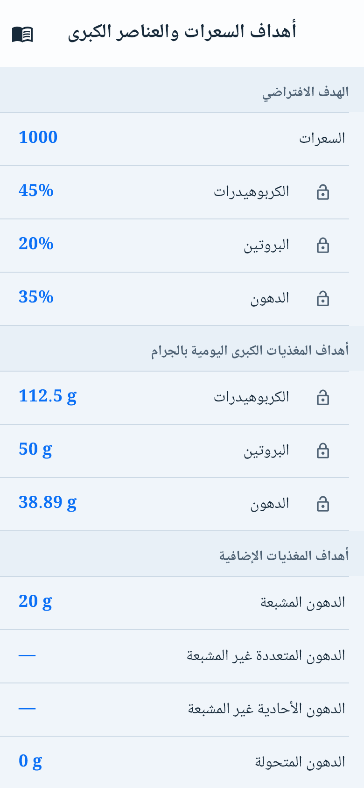
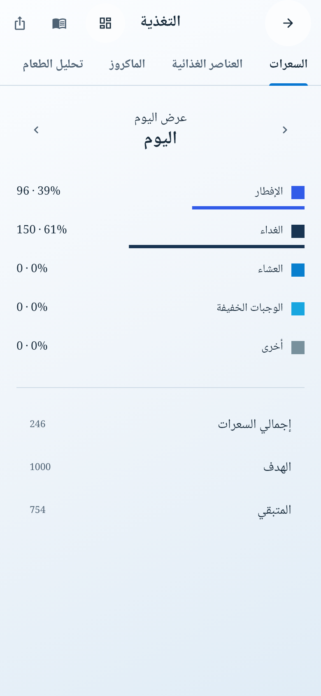

> تحديث13أكتوبر2026: هذا سجل تاريخي لنسخته ونتائجه. الحالة الحالية والإصلاحات بعد2c518ee4 وقرار المراجعين في [التقرير الجامع](BIL_20261013_PRE_FULL_STORE_REVIEW_CLOSURE_AR.md). نتائج1292 القديمة لا تنسب للمصدر الجديد. nutrition/goalsV2 أصبحت منفذة واختُبرت محليًا، دون نشر. الشاملة مأذونة مرة واحدة بعد الإغلاق، ولم تبدأ أثناء الإصلاحات. حالة الحسابات/artifact/Console تبقى غير مثبتة؛ السماح برفع Play ليس شرطًا لإعداد Appeal أثناء التعليق.

# BIL — إغلاق استعادة التغذية والأهداف، 12 أكتوبر 2026

الأساس المحلي والبعيد المحفوظ: `2c518ee469fa5c14f9d9e2c496340b6c4811d57f`، على فرع `integration/bil-qa-media-policy-20261011`. هذه إضافة فوق تسليم1292؛ نتيجته تخص مصدره، ولم نعد تلك المجموعة من الصفر. SHA كوميت الإضافة يُعرض في سجل Git وتسليم المحادثة. [فهرس الأدلة والبصمات](evidence/cloud-restore-v2-20261012/results.json) يحدد كامل مصدر هذه المرحلة بدقة.

هذا تقرير مرحلة الاستعادة الأولى قبل إضافات المالك اللاحقة للوجبات والأسهم والترجمة والعدادات وشارة Premium وربط Goal/Left. بصمة تلك المرحلة: `7a5e861f98cb95b6581bb522b3fac2c059b14ac1f550fcc60ac98c902f598312`؛ليست بصمة الكود النهائي بعد الإضافات. [تسليم الإضافات ونتائج المصدر النهائي](BIL_20261012_STAGE1_ADDITIONS_CLOSURE_AR.md) يحدد التغييرات وإعادة الاختبارات ودورة الخادم الجديدة والتحليل النهائي. Flutter3.44.6 / Dart3.12.2، Windows، PostgreSQL17.6 محلي، SQLite مستقل، AES-256-GCM فعلي عبر .NET ببيانات ومفتاح اختبار معروفين. ليست هذه بيئة Production أو Supabase Auth/PostgREST كاملة، ولا اختبار هاتف أو TestFlight.

## التنفيذ الذي أغلق النقص

`CloudManualSyncService` يواصل المسار القديم لـprofile/weight/hydration، ثم يفاوض عقد V2 المستقل ويشغّل التغذية والأهداف التي وافق عليها الحساب صراحة. `CloudRestoreV2Engine` يصل إلى محول Supabase، ودفتر محلي دائم في قاعدة المستخدم، و`CloudNutritionSnapshotCodec` الذي يجهز البيانات ويطبقها فعليًا. لم نكتفِ بتخزين JSON في inbox. العقد القديم و`AppDatabaseCloudInboxApplier` يبقيان مسؤولين عن أنواع V1؛ اختبار partial محفوظ وأصبح يستخدم إصدار99 غير المدعوم فعلًا.

| طلب | تنفيذ فعلي | اختبار ودليل | النتيجة |
|---|---|---|---|
| A→تشفير→خادم→تنزيل→B فارغة | SQLite A وB ملفان مختلفان؛ نقل SDK HTTP إلى PostgreSQL، ثم فك AES وتطبيق Drift | `cycle-proof.json` و`cycle-flutter.log` | PASS؛6 سجلات أصلية، ثم تعديل/حذف وإعادة محاولة |
| الوجبات والعناصر وعلاقاتها | سجل meal يجمع كامل عناصره وتعاريف الغذاء المطلوبة؛ UUID يقابل ID محليًا | codec وcycle؛ تسلسل B يبدأ من100 | الهويات والعلاقات متساوية، IDs مختلفة؛لا عنصر يتيم |
| غذاء مخصص ووصفة ومصادر وحصة جزئية | food مستقل، recipe بمعرّفه الأصلي وروابط `local:<uuid>`، ولقطة serving | codec وrecipe serving وcycle | حفظ0.5 حصة دون اختراع وزن بالغرام |
|19 مغذيًا والمجهول/الصفر | JSON الدليل التاريخي، المصدر، الوحدة والقناع محفوظة حرفيًا | مقارنة جميع `FoodNutrient.values` | transFat مجهول،cholesterol صفر معلوم،لا إعادة حساب من كتالوج أحدث |
| الأهداف كوحدة متسقة | جميع مفاتيح snapshot والنسخ الأصلية `goal.backup.v1.*` والجداول والأقفال ومصدرها ونسخة المرجع | atomic goals وcodec وcycle |1000/45%/20%/35% و112.5/50/350÷9 محفوظة بدقتها |
| المفاتيح القديمة | raw `goal.vitaminA=10` يبقى نفسه؛ لا مقام مخمّن أو تحويل إلى mg/mcg | snapshot/recovery وcycle | مفتاحmcg لم يُختلق؛ تفسير الحالة واحد بعد الاستعادة |
| موافقة جديدة | اختياران مستقلان للتغذية والأهداف بعد الموافقة الأساسية؛سحب محلي فوري وإيصال خادم | repository/SDK transport/UI 320px2× | لا تفعيل عند الترقية،ولا Coach history |
| التعارض | expected_revision مقابل إصدار خادم؛لا ترتيب بساعة الجهاز؛قرار صريح بواجهة Settings | جهازان يعدلان الأهداف،token المراجعة،وتغير نسخة الخادم | المحلي محفوظ؛CAS جديد بعد القرار؛نسخة الاستعادة محفوظة |
| حذف وإعادة محاولة | tombstones خادم،operation_id ثابت وfingerprint للطلب،ciphertext لا يعاد توليده | SQL متزامن وcycle فقد الرد بعد commit | لا تضاعف،ولا إحياء معرف محذوف بجهاز قديم |
| توقف منتصف الدفعة/فساد/مفتاح مفقود | تطبيق العلاقات وإيصالاتها والمؤشر داخل معاملة SQLite؛نسخة/هوية/مفتاح الدليل تُفحص قبل التطبيق | codec/engine/SQL | rollback،لا مسح للمستخدم،ولا completed قبل التطبيق |
| حساب/موافقة/جهاز | lease يتقاعد عند A→B→A؛حارس بعد SDK token refresh؛Auth.uid وRLS وقفل خادم | SDK refresh وengine وSQL sessions | لا كتابة للحساب الآخر،وسحب الموافقة/الجهاز يوقف الوصول |
| Today/الأهداف/التحليلات/Coach | مستودعات ومزوّدات B وresolver الفعلي؛صفحات Flutter الحقيقية | readers وcycle والصور أدناه | مجموع246=96+300×0.5؛هدف1000 ومصدر الجدول محفوظان |
| First Use/الاحتفال | تطبيق تاريخي مباشر،وتعيين done فقط عند غياب المعلم | codec/milestone/FirstUse وcycle | لا احتفال وجبة جديد،ولا شراء/رصيد/صلاحية مستعادة |
| reset/استرجاع SQLite | token مجموعة البيانات مستقل عن سجل المزامنة؛أرشفة pending قبل إعادة مؤشر التنزيل | `local reset does not turn...` | المسح المحلي ليس أمر حذف النسخة السحابية |
| الأداء | لا تحميل لكتالوج البحث الكامل؛انتقاء custom/referenced foods وتجميع العناصر حسب الوجبة | SQLite فعلي مع500 غذاء كتالوج غير متعلق | ≤3 صفوف غذاء في أكبر نتيجة قراءة؛لا ادعاء latency هاتف |

## العقد والموافقات والتوافق

الهجرة الإضافية الوحيدة: [`20261012052335_cloud_nutrition_goals_restore_v2.sql`](../../supabase/migrations/20261012052335_cloud_nutrition_goals_restore_v2.sql)، SHA256 `ccacdcef47bf2ff0e3d438826da6fc285015c4554e157834bdea052b5ee73966`. أُنشئت باسم Supabase CLI. توجد جداول V2 مستقلة للسجلات والموافقات وإيصالات العمليات، وتسلسل تغيير صادر من الخادم؛لا تعديل لمعنى جداول أو RPC قديمة.

- `bil_cloud_restore_capabilities_v2()` يعيد protocol2،scopes nutrition/goals،policy1 وحدود100.
- `bil_cloud_restore_consent_v2()` يقرأ الاختيارين؛عدم وجود إيصال يعني غير ممنوح. `bil_record_cloud_restore_consent_v2(p_scope,p_granted,p_policy_version)` يسجل الاختيار،ولا يوسّع موافقة cloud_sync1 القديمة. يوجد مرآة محلية للنية/السحب وليست سلطة منح.
- `bil_sync_records_v2(p_device_id,p_scope,p_cursor,p_operations,p_limit)` يعيد receipts،records،cursor،has_more. العملية تحمل operation_id/type/id/expected_revision/mutation/payload_version2/payload المشفّر. لا ownerId من العميل؛الخادم يستخرجه منAuth.uid ويرفض حقول تزوير إضافية.
- هوية owner/scope/type/id/deleted/version/key_id موجودة داخل النص المحمي بالتشفير وتُقارن بالصف الخارجي بعد الفك. فقد المفتاح أو اختلاف key_id يوقف التطبيق والمؤشر؛لا إنشاء بيانات بديلة. تدوير المفاتيح ونشر key ring يحتاجان عقدًا لاحقًا،ولا يتسبب غيابهما بمحو السجل القديم.
- غذاء/وصفة/وجبة محذوفة لا تُعاد بupsert للمعرف نفسه. الإنشاء الجديد له هوية جديدة. العودة للأهداف التلقائية snapshot فارغة قابلة للتحرير،وليست حذفًا دائمًا لهوية الأهداف.
- خادم بلا V2 يعرض عدم الدعم ويحافظ على العمل المحلي؛لا استعمال V1 بمعنى جديد. التحقق غير المحسوم لا يعطي وقت نجاح شاملًا كاذبًا. وقت آخر نجاح وسبب التعليق محفوظان لكل حساب.

| العميل | schema الحالي المجمد في fixture | schema الحالي+الهجرة |
|---|---|---|
| نقل/parser مصدر32/35 `3f0085e6e6686f2e87e9cf14789e9e578ea64159` | V1 request/response كما هي | V1 كما هي؛حتى حذف ID مماثل لا يمس V2 |
| العميل الجديد | قدرة V2 غير موجودة:unavailable صادق،لا fallback | عقد V2 والتغذية/الأهداف يعملان بعد الموافقة |

تعريف V1 قبل/بعد مطابق،وبصمة مصدر النقل القديم موثقة في `postgres-result.json`. الاختبار ينفذ عقد النقل/parser القديم وSQL،ولا يشغّل ثنائي Android32/iOS35 أو يدّعي تعديلهما. Fixture الـcatalog مأخوذ من قراءة المرحلة السابقة11 أكتوبر؛لم أقرأ Production مجددًا في هذه المرحلة ولم أنشر إليها شيئًا.

## النتائج والأخطاء التي أغلقت

293 حالة Flutter فريدة ناجحة في ملفات النطاق المختار،0FAIL/ERROR/SKIP بعد إصلاح الحالات الفاشلة؛ومنها حالة دورة PostgreSQL/AES كاملة.23 مجموعة SQL/RLS حقيقية منفصلة ناجحة. [الفهرس](evidence/cloud-restore-v2-20261012/results.json) لا يجمع إعادة التشغيل لتحسين الرقم.

| التشغيل المعتمد | النتيجة |
|---|---|
| cloud:المزامنة/الموافقة/العزل/التخزين/الاستعادة/القرّاء |181PASS،0FAIL/SKIP |
| nutrition/recipe/goals/Today/Coach/FirstUse/export/recovery |111 حالة فريدة؛109 نجحت في المجموعة،والحالتان أُصلحتا واعتمد ملفاهما10/10 |
| دورة A→PG→B والمصادر/الصور/التعديل/الحذف |1PASS،لا timeout،لا حالة غير مكتملة |
| PostgreSQL مع جلسات مستقلة وRLS وCAS وتزامن |23PASS |
| Format |3118 ملفات،0 تغييرات بعد آخر تعديل؛exit0 |

التحليل الأول أظهر34 ملاحظة؛أُصلحت دون ignore أو تعديل lints أو ترقية حزم. التحليل الكامل لتلك المرحلة: No issues found،exit0؛النتيجة في الفهرس و`analyze-final.log`. لا يُعتمد خروج Analyze قديم لمصدر أحدث؛التحليل بعد الإضافات موثق في تسليمها.

أسباب الإصلاح: نقص التطبيق العلاقي والموافقات والأهداف أصلًا؛تعارض وهمي عند إعادة أهداف تلقائية أو تعديل محلي خلال إقرار رفعه؛مسح محلي كان يمكن أن يُفهم حذفًا سحابيًا؛حارس ملكية لا يعد الغذاء المخصص والأهداف/الوصفات بيانات شخصية؛مؤشر انتظار أثناء مجرد تأكيد الموافقة؛وتنظيف جلسة Semantics ومؤقتات Drift في أدوات الاختبار.

توقعا اختبار الوحدة القديمان لم يعودا مطابقين لعقد المصدر المحفوظ في2c: الحصة غير الموثقة تحفظ `unit_food_v1:local` ودليل مصدر `local`،والكتلة المعلومة0.5kg تُحفظ500g في اللقطة مع بقاء غذائها الأصلي0.25kg. عُزز اختبار المصدر/الدليل والثقة والتحويل والتعديل بدل حذف assertions أو تغيير محرك الوحدات. الوصفة300kcal لكل حصة؛نصفها150،ولا تُقسم على عدد الحصص مرة أخرى.

المحاولات الفاشلة والمتوقفة محفوظة في `earlier-attempts`. أسباب أدوات الدورة شملت fake widget clock لتهيئة SDK/خطوط/streams،JWT تركيبي بلا role،JSON null لRPC بلا معاملات،وتداخل ساعة الواجهة مع معاملة Native لاحقة. أصبح الرسم في قاعدة مستقلة تستعيد اللقطة نفسها من الخادم،بعد اكتمال معاملات A/B؛لا نسخ SQLite ولا تصدير/استيراد بدل السحابة. هذه المحاولات ليست PASS مخفية.

اختيار النطاق: مصدر جديد يمس cloud/manual sync،account boundary،preferences،food/recipe/meal evidence وgoal readers. لذلك شُغّلت ملفات السحابة والمتأثرات المذكورة،ولم تُعد1292. بعد اعتماد181 حالة السحابة تغير توقعا اختباري الوحدات وأداة التصوير،وأزيل import غير مستخدم من نافذة التعارض. أثبتت إعادة تركيب البصمة أن فرق lib هو سطر import وحده؛لا تغيير SQL. أُعيد ملف المحرك/نافذة التعارض23/23 وملفا الوحدات10/10 والقرّاء والدورة الحقيقية بعد التغيير. الفهرس ينشر بصمة كل تشغيل ودلتاته وأسباب الاحتفاظ بالنتائج غير المتأثرة. نتائج مصدر سابق لا تُنسب للتعديلات التي لم يختبرها.

## صور تشغيل فعلية

صور العربية من قاعدة عرض مستقلة أعادت نفس سجلات PostgreSQL الأصلية (الهويات/القيم/المصادر/البصمات متطابقة). لم تُستخدم صور قديمة أو صور مولّدة أو Golden جديدة. قرّاء Today والأهداف والتحليلات وCoach اختُبروا من SQLite؛قيم الوجبة/الهدف لم تُحقن بـAsyncData في الواجهة. صلاحية عرض المغذيات في أداة التصوير fixture تركيبية مستقلة معلنة؛ليست إثبات اشتراك منشور. اللقطة السابقة أظهرت إعادة محاولة لأن FreePlan المحلي ليس تفويض خادم؛صُحح الاختبار وتأكد من النص المرسوم للماكروز وحدود الهدف،دون تغيير الواجهة الإنتاجية. تحذير Drift عن مثيلات متعددة محفوظ في logs؛قواعد الاختبار تستعمل executors وملفات مستقلة،ولم يُعطل التحذير.

## النشر والجهاز ومصفوفة التسليم السابقة

التنفيذ المحلي المكتمل هنا: العقد/الهجرة/الموافقة/المحرك/التطبيق/التعارض/العزل/الاختبارات. انتظار النشر لا يُستخدم لتغطية نقص هذه الأجزاء. يتبقى تفعيل مأذون للهجرة بعد أخذ backup للschema والسجلات والمفاتيح،والتحقق من تطابق V1 وACL/RLS قبل وبعد،ثم اختبار نسخة العميل الجديدة في staging. لا حاجة لنشر Edge Function جديدة لهذا العقد. عند الرجوع يُوقف تفعيل V2 وتُحفظ بياناته ومفاتيحه وإيصالاته؛لا drop أو محو حقوق/سجلات لاستعادة نسخة عميل أقدم.

الجهاز المتبقي: iOS/Android لنقل SDK/Auth الحقيقيين،CryptoKit/JCA وsecure storage،restart والخلفية والشبكة البطيئة وفقد/استعادة المفتاح وتبديل الحساب والجهاز/المنطقة الزمنية. لا نعلن اجتياز Production أو TestFlight أو الثنائية32/35 من اختبارات Windows. وضع مراجعةbuild35 والمتاجر لم يُغيّر.

في مرحلة الاستعادة وحدها بقيت الأسطح السابقة محفوظة. إضافات المالك اللاحقة عدلت عرض الوجبات والأسهم وتفاعل أيقونات الشريط وترجمة المجتمع والعدادات والقفل الذهبي وربط أهداف التحليلات؛هذه التغييرات مصنفة ومختبرة في تسليم الإضافات،ولا يصح وصف جميع ملفاتها بأنها لم تتغير. تصميم الساعة والسبلاش ومعالم FirstUse/الاحتفال وحقوق الشراء بقيت محفوظة. خطط النشر واختبار الأجهزة وقرارات السياسة تبقى بحدود تقاريرها السابقة.

لا Full8،ولا flutter test للجذر،ولا بناء/توقيع/رفع،ولا تعديلmain/Production/أسعار/Trial/متاجر،ولا Appeal. الدفع العادي إلى الفرع المحدد بكوميت واحد `[skip ci]` بعد فحص الرأس والtriggers؛لا force/squash/rebase. صور فشل الساعة الأربع الأصلية بقيت خارج staging.

أوامر قابلة لإعادة الإنتاج: `bil_stage1_closure_runner.py` بملفات الاختبار الصريحة المسجلة فيJSON،`bil_postgres_restore_v2_test.py --psql <local-psql>`،و`bil_cloud_restore_cycle_runner.py --label <fresh-label> --psql <local-psql> --pwsh <pwsh> --flutter <Flutter3.44.6>`. أداة الدورة ترفض عنوانًا خارجloopback وتستعمل قاعدة اختبار جديدة ثم تغلقها. لا إجراءProduction أو اختيار جذر الاختبارات ضمن هذه الأدوات.

مراجع التصميم الأمني التي فُحصت12 أكتوبر2026: [Supabase RLS](https://supabase.com/docs/guides/database/postgres/row-level-security)،[migrations](https://supabase.com/docs/guides/deployment/database-migrations). RLS وGRANT مستقلان؛SECURITY DEFINER له search_path مقيد،وإدارة القرار والموافقة مشتقة من الخادم. لا إضعاف لRLS القائمة ولا توسيع صلاحيات المشرفين.

فحص الدفع الأولي: origin عند2c518ee4؛أحدث CI مقروء38136049208 ناجح علىebd0ffd،ولا يُنسب إلى هذا المصدر. فحص الرأس والtriggers قبل الدفع يعاد في تسليم الإضافات. معاينة Today الأولية كانت مولدة؛لاحقًا أقر المالك تعديل الوجبات وتفاصيلها،فنُفذ في Flutter والتُقطت صور فعلية موثقة في التسليم الجديد. لا تُستخدم المعاينة المولدة كدليل تنفيذ.
