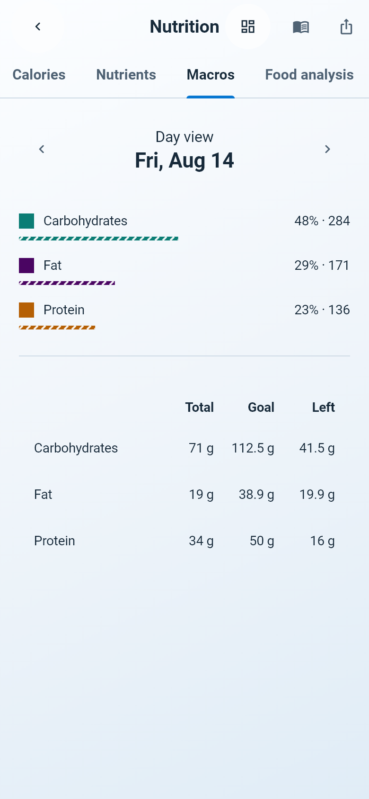
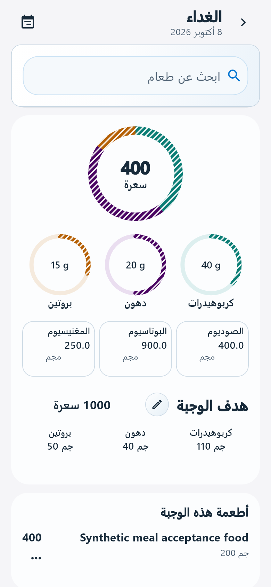
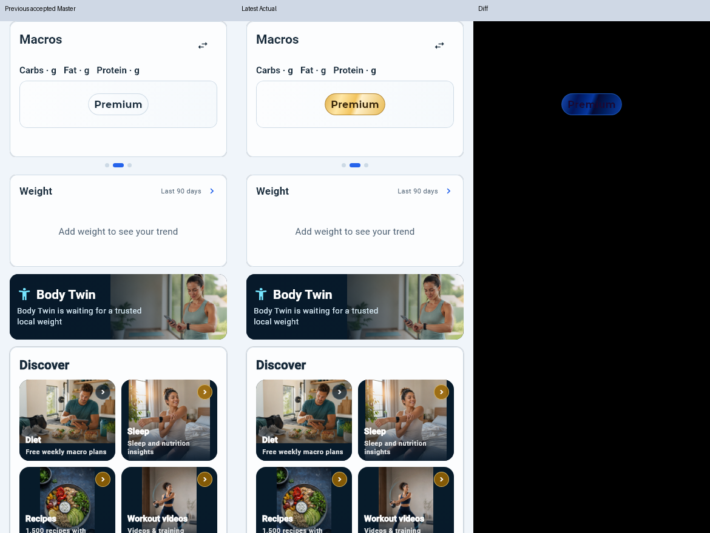
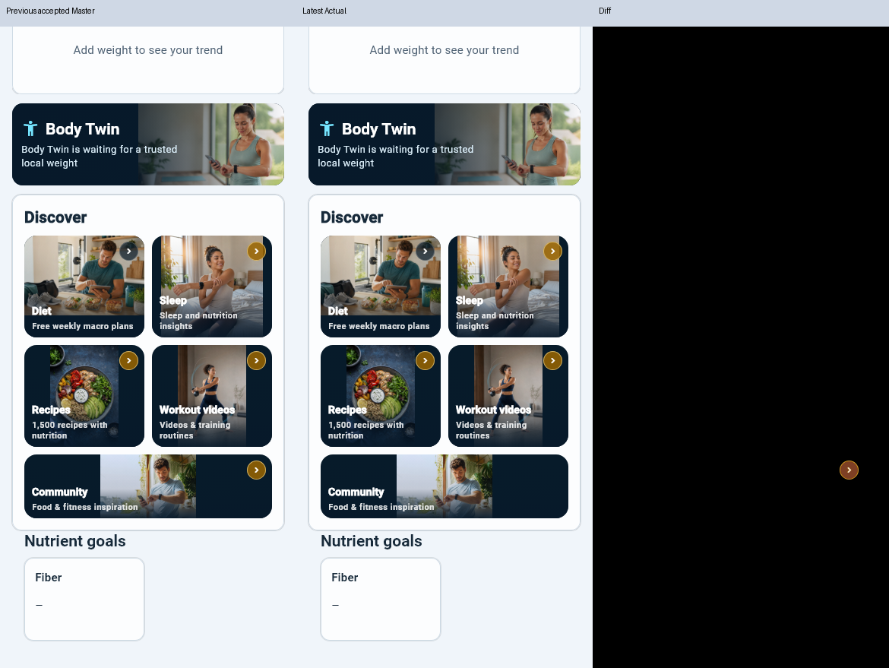

# BIL — استكمال الاستعادة وإضافات الواجهة والاشتراك والأهداف

الأساس المحفوظ: `2c518ee469fa5c14f9d9e2c496340b6c4811d57f`. فرع الدفع الوحيد: `integration/bil-qa-media-policy-20261011`. هذا استكمال فوق التقرير السابق، دون reset/clean/squash/rebase أو تبديل المصدر إلى SHA قديم. SHA الكوميت الجديد يحدد من سجل Git الذي يحتوي هذه الوثيقة. بصمة مرحلة الإضافات السابقة بعد تنظيف نهايات الأسطر (وليست بصمة الإغلاق الجاري بعد مراجعة Golden): `abea383001728f2bedd2ae7c2827e2ce405328baa0c75724cab321d59ca45782`، والقائمة الكاملة في [source-inputs.json](evidence/stage1-additions-20261012/source-inputs.json).

Flutter 3.44.6 / Dart 3.12.2، Windows، PostgreSQL 17.6 على loopback، وقواعد SQLite مستقلة. كل الصور أدناه من تشغيل Flutter؛ صلاحية الاشتراك/المتجر ومحرك النص التركي في اختبارات الواجهة fixtures معلنة. لا Production أو TestFlight أو هاتف في هذه النتيجة. لا تُنسب نتيجة1292 السابقة أو CI قديم إلى هذا المصدر.

## الإجابة على «هل نُفذ كل المطلوب؟»

لا يصح إعلان اكتمال جميع الطلبات في النسخ الفعلية. نُفذت الإصلاحات المأذونة في المصدر وجرى التحقق المحلي الموثق أدناه، لكن اختبار محركات الترجمة الأصلية على iOS/Android، قياس شراء لارا على هاتفها، رحلة المراجع في النسخة المقدمة، حالة Console الحالية، التوافق بثنائيات32/35، ونشر العقود ليست معتمدة هنا. التشخيص السابق الذي كشف57 فرق Golden توسع لاحقًا إلى مراجعة258 حالة فردية؛ القرارات والصور في [تقرير Golden الجاري](BIL_20261012_GOLDEN_REVIEW_AND_OWNER_FULL_AR.md). رُفضت16 صورة وصفات وأُصلح تداخلها ثم أعيدت صور17 حالة. نجحت ملفاتGolden والمجموعات المتأثرة في420حالة/22ملفًا، ثم8مراجعiPad بعدLF و70حالة في3ملفات متأثرة؛ النتائج مفصلة في التقريرالجديد ولا تُجمع المتداخلات كحالات فريدة. بعض إجراءات المجتمع تنتظر سياسة معلنة قبل التفعيل. أذن المالك لاحقًا بشاملة واحدة دون تقسيم بعد إغلاق Golden ونجاح التحليل؛ لم تبدأ بعد في تحديث هذه الوثيقة. البناء والنشر والاستئناف ما زالت غير مأذونة.

المراجعة تأخذ آخر تعليمات المالك عند تعارض الرسائل: لا Full8؛ المسموح شاملة واحدة دون sharding بعد Golden والتحليل، ثم يتابعها المالك ويتوقف الوكيل، لا إعادة تصميم Home أو الساعة، تعديل الوجبات دون تغيير ملخص السعرات والماكروز للمشترك، كتاب واحد في صفحة الأهداف والتنبيه داخل محرر الحقل فقط، والأهداف الخاصة بالوجبة منفصلة عن اليومية. طلب «هل Stories موجودة؟» فُحص وأُجيب بصدق؛ لم يُطلب بناء نظام قصص مستقل ثم يُدّعى إنجازه.

## مصفوفة الرسائل والقبول

| طلب المالك | التنفيذ الفعلي / الإثبات | الوضع الحالي |
|---|---|---|
| إصلاحات QA القديمة و29Golden وVision/BodyTwin | محفوظة في2c وسلسلة تقارير9–12أكتوبر؛ أُعيدت ملفات المتأثرات فقط | نتائجها السابقة تخص مصادرها؛ لا Full قديم منسوب للجديد |
| استرداد10 ملفات First Use من patch لا من الذاكرة | [إثبات الاسترداد السابق](BIL_20261011_FIRST_USE_RECOVERY_INTEGRATION_PROOF_AR.md)، سلوك Skip والأهداف الحقيقية/معلم أول وجبة محفوظ | الملفان الرئيسيان للإرشاد والاحتفال مطابقان لـ2c؛ اختبارات الاستعادة لا تطلقهما مجددًا |
| الصور الشخصية والخاصة والكاش والموجز والسبلاش | تنفيذ2c وفهرس1292؛ اختبارات المجتمع/الجلسات/التحديث في هذه الإضافة | محلي مثبت؛ اختبار نقل/دورة حياة هاتف يبقى لازمًا |
| البحث المبكر والصوت وعدم مسح تعديل متأخر | تنفيذ2c محفوظ؛ اختبارات البحث/الصوت/المالك ضمن النطاقات المتأثرة | لا نشر لتعديل food-search؛ المصدر المحلي فقط |
| النوافذ وCoach/settings/history وإعادة تسمية ثابتة | إصلاحات2c واختبارات الحفظ/الرد/الحذف/العزل محفوظة، مع تفاعل الأسهم الجديد | لا رفع محادثات Coach إلى السحابة |
| Pearl/Silver polish مع حماية المناطق | Shared surfaces في2c؛ هذه الإضافة للوجبات والأسهم والعدادات والذهبي المحددة | صور Before/After فعلية؛ لا ادعاء قبول بصري لكل شاشة غير مصورة |
| قفل القيم فقط والأجهزة والعناوين والأخطاء | أصل2c محفوظ؛ الذهب لا يغير الحدود أو التفويض؛ Checking/Error لا تصبحان عرض ترقية | اختبار Semantics/ضغط/تبديل/اشتراك؛ لا فحص BLE/HealthKit على جهاز |
| استعادة nutrition/goals فعلية | V2 إضافي، موافقتان مستقلتان، codec علاقات، دفتر دائم، CAS/tombstones، SQLite A→AES→PG→SQLite B | مكتمل محليًا، غير منشور؛19 مغذيًا وصفر معلوم/مجهول وصور القرّاء |
| أهداف/غرامات/نسب/أقفال ومصادر | resolver والحفظ الذري والمراجع في2c؛ اختبار اليوم المجدول والقراءة المتأخرة هنا | لا قيم غذائية مختلقة، ولا979 مقدمة كمقترح BIL |
| تخصيص قديم والتفسير الواحد عبر القرّاء | raw محفوظ، legacy% بلا تحويل mg مجهول، حالة مراجعة داخل المحرر وفق توجيه المالك | المصدر/اللقطة مستعادان؛ لا حذف تخصيص أو تعديل ما أكله المستخدم |
| Today أقل ازدحامًا | صف وجبة مختصر يفتح التفاصيل؛ التاريخ المختار في الوسط36px وجيرانه يوما قبله وبعده | ملخص السعرات/الماكروز للمشترك محفوظ، مع texture العدادات بطلب لاحق |
| تفاصيل الوجبة الأصلية والدوائر الكبيرة | السعرات136px والماكروز82px فعلية؛ استهلاك داخل الدائرة والهدف أسفل؛ لا /1000 فوق | هدف دهون40 واستهلاك20 يرسم نصف الدائرة؛ اختبار SQLite وضغط حقيقي |
| أملاح الوجبة والشرطة | sodium/potassium/magnesium من نفس عناصر الوجبة، لا مجموع اليوم؛ dash عند المجهول وصفر معلوم محفوظ | صور واختبارات، لا Unavailable في هذه الحقول |
| هدف الوجبة وزر التعديل والعودة | نفس عنوان الوجبة/هدفها، زر34 مع hit48؛ يفتح محرر More الحقيقي ويعود لنفس الوجبة/التاريخ |31 حالة مصفوفة+4رحلات تعديل، لا fallback يومي إلى هدف الوجبة |
| الأسهم كلها وفق الفقاعة والخمس أيقونات | تزيين AST محدود يحفظ callbacks/keys/routes؛ SDK back/dropdown/calendar و5glyphs |47 نوع سهم، فحص نهائي0 موضع صريح غير مغلف؛ اختبارات الضغط/RTL/2× |
| ألوان عدادات المرجع والشرائط | أزرق calories، teal carbs، بنفسجي fat، amber protein؛ painter static للبارات والأقواس | النسب والقياسات الأصلية وSemantics محفوظة؛ loading/status/splash مستثناة |
| Premium ذهبي ويذهب إلى Plans | metallic gradient بنص داكن؛ شارة فعلية أو إجراء القفل القائم، مصدر صلاحية موثق | test5 للضوء/الداكن/AR/EN/2× وتباين≥4.5؛ loading/error ليست Free |
| المجتمع مجاني والسهم الذهبي يُزال | Discover Community بلا السهم الذهبي وبلا ربط باشتراك | ضغط فعلي أثناء Checking وأثناء verified Free يصل إلى/community |
| كل خطة تزيل أقفال ما تتضمنه |4SKU:Premium/AI شهري/سنوي × active/trial؛ طابور الشراء الحقيقي ومزوّدات الوصول |8/8؛ أقفال المغذيات تزول والإجراء يعمل قبل تحرير finish المحبوس |
| Goal وLeft في Nutrition | أهداف اليوم المختار من التخزين؛ Goal−Total، عرض عشري مع حفظ الدقة الداخلية |112.5−71=41.5؛ بعد تعديل الهدف90−71=19؛ تحميل/error لا يستبدلان الهدف بآخر |
| ترجمة منشور/تعليق/رد إلى لغة التطبيق | أصل أولًا، ضغط لترجمة محلية وتبديل للأصل؛ native bridges iOS/Android، إلغاء/عزل/كشف محلي | Flutter مثبت بمحرك تركي تركيبي؛ native compilation/model/device غير مختبر |
| هل يوجد إنشاء Story؟ | المصدر ينشئ منشورًا عاديًا؛ الاسم الآنCreate post/إنشاء منشور | لا توجد Stories مؤقتة أو دورة إنشائها؛ ليست ميزة مكتملة |
| شراء لارا والسرعة والتهنئة | إصلاح الفصل بين benefit/finish والتهنئة في2c؛ توسعة4منتجات هنا | تأكيد محلي صحيح؛ لا تشخيص زمني من هاتف لارا ولا P95 جهاز |
| Google/Apple والمراجع والاستئناف | [التدقيق](BIL_20261011_APPLE_GOOGLE_ANDROID_STRICT_AUDIT_AR.md)، [مسودة Appeal](BIL_20261011_GOOGLE_APPEAL_PREPARATION_AR_EN.md)، [نصوص المتاجر](BIL_20261011_STORE_REVIEW_TEXTS_AND_TIMING_AR_EN.md) محفوظة | لا ضمان قبول أو «حُل التعليق»؛ لا Appeal وفق تأكيد المالك ولم نرسل شيئًا |
| الإدارة/المنح/مراجعة المجتمع | [مصدر V2/دفاتر/أدوار واختبارات الخادم السابقة](BIL_20261011_ADMIN_COMMUNITY_CLOUD_COMPATIBILITY_AR.md) محفوظ | غير منشور؛ نشر فقط ينتظر سياسة، لا منح/Reset/تغيير مشرف حقيقي |
| السحابة وتوافق32/35 | RPC V1 دون تغيير، V2 منفصل، اختبار SQL/RLS23 وحقيقة غياب قدرة V2 | عقد النقل القديم مثبت، لا تشغيل binaries32/35 أو مصفوفة أجهزة شاملة |
| الشاملة والبناء وProduction والمتاجر | أذن المالك بشاملة واحدة دون sharding بعد Golden وFormat وAnalyze؛ التشغيل المستقل يكتب logs/PID/status ويتوقف الوكيل | لم تبدأ الشاملة بعد؛ iOS36/Android33 إعداد مرشح بلا artifact، ولا بناء/نشر/شراء حقيقي |

## نتائج المرحلة السابقة المحفوظة وحدودها

هذه النتائج تخص المصدر والبصمات المسجلة وقت تشغيلها، ولا تُنسب تلقائيًا إلى تعديلات Golden أو خط Today أو أدوات الالتقاط اللاحقة. اعتمادGolden وFormat للإغلاق الجاري موثق الآن في [التقرير الجديد](BIL_20261012_GOLDEN_REVIEW_AND_OWNER_FULL_AR.md):420حالة/22ملفًا،8iPad،70إعادة متأثرة،3159ملفDart دونتغيير، و9اختباراتأداةPython. تحليلالإغلاق الجاري ينتظرنتيجته؛ الشاملة لم تبدأ.

[فهرس النتائج](evidence/stage1-additions-20261012/results.json) يسجل1082 حالة ناجحة فريدة عبر مراحل الاستعادة والإضافات، بعد استبدال المحاولة الفاشلة بنتيجة إعادة الاختبار وإزالة ازدواج إعادة التشغيل.بدأ الفهرس بـ293 هوية حالة من مرحلة الاستعادة، ثم أضاف789 هوية حالة جديدة ضمن الإضافات؛ لا تُجمع1292 معها. لكل تشغيل بصمة ودلتا إلى المصدر النهائي؛ هذا **ليس تشغيل1082 حالة دفعة واحدة على SHA النهائي ولا Full**. نتائج المجموعات غير المتأثرة محفوظة بعد مراجعة أثر التغيير.

| آخر اعتماد / مجموعة | PASS | FAIL/ERROR/SKIP | ملاحظة |
|---|---:|---|---|
| ملفات إصلاح التحليل والذهب والصلاحية وجدول الأهداف |85|0/0/0|5ملفات، قبل تنظيفCRLF فقط |
| الشراء والحوارات ومراجعة13صورGolden |28|0/0/0|7حجب+8اشتراك+13مراجعة؛ ملفschedule في أمر الفلتر لم ينفذ، واعتمد منفصلًا ضمن85 |
| تسمية الخطة وسحب صلاحية الوصفة وذهبي التمرين |17|0/0/0|3ملفات، بما فيها ضغط الشارة الحقيقي |
| ماكروز الوجبة والقرّاء والأسهم والتباين |90|0/0/0|بعد إصلاح التباين وتوقعات البيانات؛ اختلافات لاحقة بصريًا معتمدة أعلاه |
| الاستقرار والخلفية/صوت/Vision/FirstUse/فلترة المجتمع |86|0/0/0|اختبارات وظيفية؛ لا مكافأة أو نشر تلقائي |
| مجموعة عدادات22ملفًا أولًا |179|1/4/0|محاولة تشخيص محفوظة؛ توقع9000 تقنيًا وتباين4.34 أصلحا وأعيدت الحالات/الملفات |
| مجموعة الذهب/الخطط17ملفًا أولًا |128|0/3/0|توقعAI Coach القديم وkey veil بعد سحب الصلاحية؛ أصلحها ملف17/17 |
| دورة SQLite A→PG→B الجديدة |1|0/0/0|أعيدت بعد تنظيفCRLF على البصمة النهائية؛ التفاصيل في الفهرس |
| PostgreSQL/RLS/CAS بجلسات مستقلة |23|0|الهجرة وfixtures لم تتغير بعد التشغيل |
| Format strict في المرحلة السابقة |3008ملفات|exit0،0تغييرات|نتيجة تاريخية؛ يلزم اعتماد جديد بعد آخر تعديل جاري |
| Flutter Analyze كامل في المرحلة السابقة |No issues found|exit0|المحاولة6ملاحظات أصلحت بلاignore؛ نتيجة مصدرها السابق، والاعتماد الجاري ينتظر سجله |

جميع إخفاقات المحاولات المختارة، بما فيها timeout أدوات الاختبار وGolden قبل القرار، محفوظة في [سجل المحاولات](evidence/stage1-additions-20261012/attempts.json). timeout لا يسمىPASS. اختبار9000 أعيدت صياغة اسمه وتقوية توقعاته: raw يبقى قابلًا للاستعادة لكن لا يصبح هدفًا صالحًا خفية، مع رفض السالب وغير المنتهي والوحدة المجهولة والحد التقني المتجاوز. لم يحذف اختبار وظيفي أو تُخفف thresholds.

فحص Git كشفCRLF أضافتها كتابة النص علىWindows إلى22 ملفًا معدّلًا/جديدًا. حُفظت bytes المختبرة أولًا، ثم أزيلCR قبلLF فقط، دون تغيير ملف غير معدل أو fixture تاريخية. [البصمات قبل/بعد](evidence/stage1-additions-20261012/line-ending-normalization.json) تثبت التطابق بعد تطبيع نهاية السطر لكل ملف؛ `git diff --check` أصبح نظيفًا. أعيدت ملفات النقل/المحرك/الترجمة/الشراء والصور13، والدورة الفعلية والتنسيق والتحليل بعد ذلك. البصمةd983 في التشغيل الأقدم محفوظة بحدودها، وليست بصمةالكوميت النهائية.

**تشخيص مرئي غير معتمد:** استدعاء بعد تنظيف الأسطر احتوى بديلregex `.*` بالخطأ، فاختار خارج13 حالة المقصودة. أوقفناPID المملوك بعد التحقق منcommand line. سجّل16PASS و57GoldenERROR وحالةcommunity signed-out غير مكتملة؛جميع الاستثناءات المكتملة كانت مقارناتصور،ولا يُستنتج أنها كلها قديمة أو مقصودة دون مراجعة. لم يغير أيMaster ولم يُحسب ضمن الاعتماد. [الأسماء والسجل و228صورة Master/Actual/Diff](evidence/stage1-additions-20261012/unreviewed-visual-diagnostic/result.json) محفوظة. كانت هذه57 فروق غير معتمدة وقت التشخيص، وليست نتيجةFull. حُفظت المحاولة دون تغيير سجلها، ثم شملتها المراجعة الفردية الموسعة في [تقرير258حالة](BIL_20261012_GOLDEN_REVIEW_AND_OWNER_FULL_AR.md). حالات13 المقصودة أعيدت بأمر مضبوط منفصل؛ قبول الصور لاحقًا لا يحول نتيجة المحاولة القديمة إلىPASS.

## سبب الإصلاحات الجديدة

محاذاة meal-entry كانت تمرر البحث إلى أعلى viewport بعد زيادة طول البطاقة،فتخفي عنوان الوجبة والرجوع. أضاف الاختبار فحص حدود العنوان والضغط الحقيقي،وأصلح `_focusMealEntry` فتح تفاصيل مستقلة عندscroll0. التفاصيل العامة لليوم تبقى بسلوكها السابق.

ملفGoal schedule كان يقرأ `.value ?? empty` في Loading/Error،فيعامل جدولًا لم يُقرأ كأنه غير موجود ويستعمل هدفًا عامًا. الآن ينتظر القراءة ويعرض retry عند الفشل؛ لقطة صحيحة محفوظة لنفس المالك لا تُستبدل بإجابة قديمة. الأرقام المعروضة تستعمل عشرية واحدة دون مسح دقة الحساب. الهدف يومي في Nutrition،وهدف مستقل للوجبة في تفاصيلها.

عرض الوصفات كان يفتح `focus=boost` في سوقAI من قفل مكتبة اشتراك. أصبح `focus=subscription` بعد guard التحقق نفسه؛ شراءBoost لا يفتح مكتبةPremium. شارة مجموعة المغذيات تخفي إجراءها عندrefresh/error حتى مع بياناتFree محفوظة،واختبارها يستعمل refresh حقيقيًا منRiverpod. لا استعمال API اختبار داخلي أو إخفاء ملاحظةAnalyze.

## الخطط فوق المجاني

| المنتج | الإضافة فوقFree | ما لا يُستنتج منه |
|---|---|---|
|Free|تسجيل محلي،أساس/دليل التغذية،تحليلات محلية،تصدير،مزامنة أساسية،Community|لا اشتراك مطلوب للمجتمع؛ الموافقات الجديدة مستقلة |
|BIL Premium|adFree،advancedAnalytics،mealPlanning،connectedHealth،premiumPrograms،customGoals،advancedIntelligence؛واجهات الكتالوج تعرض وصفاتها وتمارينها وأدواتها المشمولة|لا سلطة إدارة ولا وعدAI غير محدود أو رصيد مخمّن |
|BIL Premium AI Coach|كلPremium إضافة إلىAI Coach والحصة التي يثبتها الخادم والمنتج|bool خطة محلي ليس رصيدًا؛ سعر/Trial/إتاحة سوق من المتجر |
|BIL AI Boost|رصيدTokens موثق مستقل يمكن استخدامه للـAI|ليسPremium،ولا يفتح كل أقفال الاشتراك،ولا يمنح إدارة |

بقيت الأسعار وTrial وأرصدة الحسابات وسياسة الحصة كما هي. أسماء الخطط الصحيحة وملخصAI الكامل راجعت لغاتها؛ أصلح fallback20لغة الذي كان يوحي بوراثةFree فقط. اختباراتHTTP/Store fixtures لا تثبت كتالوجProduction أو إيصالشراء حقيقيًا.

## صور فعلية ومراجعةGolden فردية

[المراجعة الأولى للـ12حالة](evidence/stage1-additions-20261012/final-golden-review/individual-decisions.json) تشمل أصل2c المثبت والصور الفعلية،وليست مقارنة Golden قديمة وحدها. [الأربعة التي تأثرت بالذهب لاحقًا](evidence/stage1-additions-20261012/final-gold-review/individual-decisions.json) روجعت واحدة واحدة ثم تغير كلMaster بعملية مستقلة تتحقق منSHA256. تغير شارةFree منpill ممتد إلىذهب مركّز،وتوسعت مساحةضغطها إلى48px؛ تحركت مجموعةFree أسفلها15px. أرقام وأهداف المشترك لم تتغير بهذا التعديل. [الحالة13الجديدة](evidence/stage1-additions-20261012/new-saved-day-goal-golden-reviewed-one-case.json) أضيف مرجعها باستدعاءexactcase فقط بعد رؤية الشاشة؛لا تحديث جماعي.

حدود الساعة مقابل2c متطابقة بكسليًا في اللقطات المحمية،وكذلك منطقة السعرات/الماكروز اليومية قبل إضافةtexture المطلوبة. لم نغير جسم الساعة أو بياناتها،ولا ترتيب الخمس أيقونات أو الهيكل أو السبلاش. تزيينضغطglyph فقط بطلب المالك. فُحصت لاحقًا مراجعiPad الموجودة بمقارناتFlutter فعلية ضمن التقرير الجديد، ومنها AI Coach بقياسviewport الحقيقي؛ نتائج إعادة اعتمادها تسجل منفصلة عن الهاتف. اختبارات320/390/430 والخط2× وصورFlutter لا تحل محلiPad فعلي.

## الحدود والإجراءات المتبقية

1. نشرV2 التغذية/الأهداف وV2 الإدارة/المجتمع وتعديل البحث يحتاج موافقة منفصلة وخطةbackup/توافق/تفعيل/رجوع الموجودة؛كلها محلية الآن. خادم بلاV2 يعرضunavailable ولا يدعي الاستعادة الكاملة.
2. ترجمةiOS/Android تحتاج compilation مأذونًا وأجهزة/موديلات حقيقية؛إفصاحSDK وتنزيلاته مذكور في [تقرير الترجمة](BIL_20261012_COMMUNITY_TRANSLATION_PRIVACY_AND_STORIES_AR.md). نجاحPort التركي لا يثبتAppleTranslation أوMLKit.
3. الشراء والHealth والسحابة المشفرة يحتاجون اختبارStoreKit/Play وCryptoKit/JCA ومفاتيحrestart على جهاز. قياساتP95100/300ms وتحديد مرحلة بطءلارا لم تُنجز؛لا وصفها كتحسنProduction.
4. GoogleSuspension لم يُلغَ. لا قراءة Console مستقلة حالية ولا نسخة مصححة مقدمة ولا Appeal. ملف الاستئناف ينتظر أدلة النسخة والدخول/الاستحقاق/رحلة الجهاز ثم موافقة المالك،لا اكتمال Polish فقط. حالة Apple35 بحسب المالك لا بحسب قراءة جديدة، ولا تغيير لها هنا.
5. نشر فقط وموافقات مالية ثانية/احتفاظaudit يحتاجون سياسة صريحة حيث تتطلبها العقود؛لم نخترع حدًا أو نفعل منحة. المجتمع يظلFree معAuth/moderation/report/block.
6. Full8 ممنوع. الجذر مأذون لاحقًا كتَشغيل شامل واحد دون تقسيم علىSHAثابت بعد إغلاقGolden ونجاحFormat وAnalyze؛ لم يبدأ بعد. البناء والتوقيع والمتاجر مؤجلة. لا تعداد8528 أوCI38136049208 إثبات لهذا المصدر.
7. اكتملت المراجعة البصرية الفردية الموسعة لـ258حالة مع صورها وأسبابها، وإصلاح16تداخلًا قبل القبول. اعتماد المراجع تم بصورة منفصلة لكل حالة258/258. نتائج المقارنة النهائية والتنسيق وأداة المتابعة مرفقة في التقريرالجديد؛ التحليل وحده ما زال ينتظرنتيجته. لا اعتماد تلقائي أو تحديث جماعي، ولا تسمية التشخيص غير المكتمل نجاحًا.

## سلامة الحفظ والدفع

فحصorigin السابق في هذه المرحلة أظهر2c ولم يظهرPRعلى فرع التكامل. هذه نتيجة فحص مؤرخة وليست إثباتHEADبعيد حالي؛ يعاد التحقق قبل أي دفع لاحق. أربعة push workflows مطابقة للفرع؛ ثلاثة لا تطابق paths، والرابع focused lib/test. لا pull_request_target/workflow_run/dispatch/schedule تلقائي في الفحص. خطة الحفظ كوميت عادي فوق التاريخ المحفوظ، دون إعادة كتابة كوميتات مرفوعة؛ ويُراجع استخدام `[skip ci]` وفق [GitHub الرسمي](https://docs.github.com/en/actions/how-tos/manage-workflow-runs/skip-workflow-runs)،ولا workflow_dispatch. لا نجاح CI مزعوم من skip. فحص triggers وبصماتها محفوظ في [preflight](evidence/stage1-additions-20261012/push-workflow-preflight.json).

صور failures ليست مراجع ولا تدخل staging؛ الأربع الأصلية للساعة المحمية محفوظة خارج الكوميت. backup قبل الدفع يحفظ patch والملفات الجديدة ببصماتها. لا تغيير main/Production/نسخ المتاجر/أسعار/Trial، ولا ForcePush/merge. أذن المالك لاحقًا بالشاملة الواحدة بعد إغلاقGolden والتحليل. بعد إثبات بدء تشغيلها المستقل وكتابةlogs/PID/status يتوقف الوكيل ويترك المتابعة للمالك؛ لا إعادة تشغيل تلقائية أو تعديل للمصدر أثناءها. الدفع إلى فرع التكامل يأتي بعد النتائج النظيفة وفحصHEADوالtriggers، لمراجعة المهندس، وليس إذنًا للبناء أو المتاجر.
